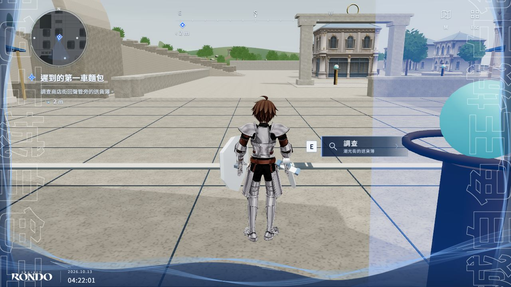
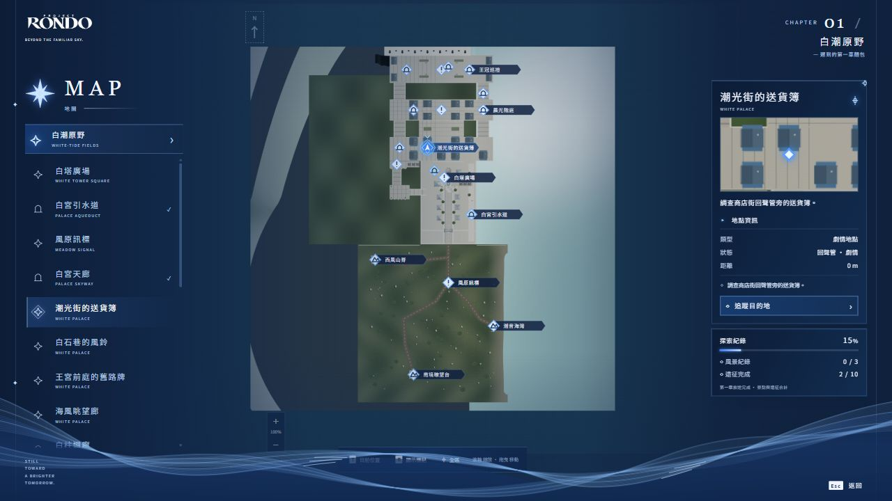
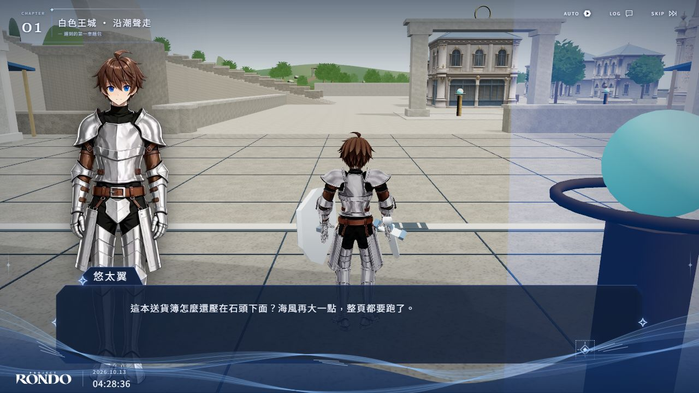
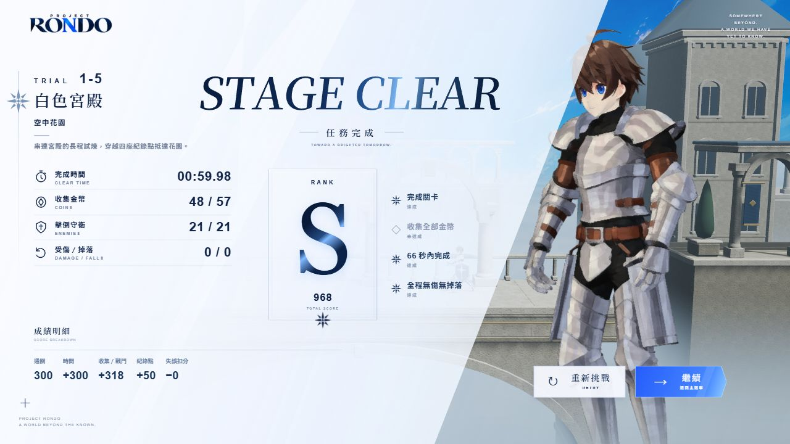
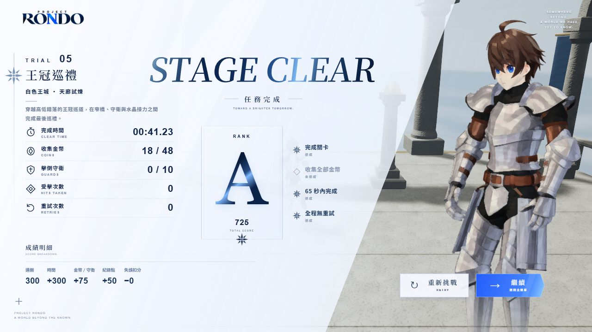

# 白色王城與八關擴充驗證紀錄

## 本版可玩範圍

王城新增潮光商店街、白石住宅區、王宮前庭與海風眺望廊，兩條坡道連成可步行環線。可從 EXTRA 的王城入口進入目前旅程；完成原主線後，HUD 會引導四段可選支線。支線由悠太翼調查送貨簿、風鈴、舊路牌與眺望盤，依序記錄，與原主線進度分開保存。

新關可從 EXTRA 直接選取，或走到王城中的入口。原有 2D／3D 關與主線條件保留。每關有獨立成績、最佳時間、收集數、重新挑戰與返回流程。

| 類型 | 關卡 | 金幣 | 特色 |
| --- | --- | ---: | --- |
| 2D | 1-2 蒼藍中庭 | 17 | 首組蒼藍核心與缺口 |
| 2D | 1-3 天空露台 | 31 | 高低露台與核心接力 |
| 2D | 1-4 拱橋 | 29 | 長橋跳躍與守衛 |
| 2D | 1-5 空中花園 | 57 | 長距離路線與四個紀錄點 |
| 3D | 02 白柱迴廊 | 40 | 偏移窄橋與雙段 Homing |
| 3D | 03 晨光階庭 | 48 | 逐級升高的平台 |
| 3D | 04 水晶星廊 | 44 | 三組連續水晶接力 |
| 3D | 05 王冠巡禮 | 48 | 升降窄橋與左右換線 |

2D 來源固定為 ProjectAlmost commit `76b9ca1c680e98e27ac9f51871bf4feffb3f0bbc`，沒有匯入 BOSS 1-6。五份關卡資料與固定版本來源核對一致；蒼藍核心是可再生的空中借力點，不計作騎士擊倒分數。既有 3D 白宮天廊也新增 37 枚金幣。

## 自動化與正式建置

- `npm run typecheck`：0 errors、0 warnings。
- `npm test`：193 個檔案、1,215 個測試通過。
- `npm run build`：通過。
- `node tools/verify-build.mjs`：正式版本所有 session CSS 預載、PWA metadata、圖示與離線頁通過。
- `git diff --check`：通過。
- 三個獨立子任務互相檢閱了 Palace、Course 與整合流程；檢閱抓到的成績計數、章節編號、王城返回與存檔備份問題已修正。

測試涵蓋全部十關選取、原有紀錄相容性、八個新入口的開啟／地圖返回／通關返回、四段支線分支收束、金幣重生規則、可達性、地面／視覺一致性與裝飾碰撞預算。既有 jsdom 媒體模擬提示及 Vite 大 chunk 警告仍存在，沒有把它們記為實際音訊或 Android 驗證。

## 真實瀏覽器驗證

使用 1280 × 720 本機頁面、正式遊戲 session 與真實鍵盤事件；所有音訊靜音，測試存檔隔離。路線助手只讀遊戲位置並送出移動／跳躍／攻擊輸入，沒有改座標、跳紀錄點或直接設定通關。

| 路線 | 實際結果 |
| --- | --- |
| 王城完整環線 | 十個路點完成；商店街、雙坡道、住宅區、前庭、舊城均走通；沒有瀏覽器錯誤 |
| 3D 白柱迴廊 | 10 座平台、4 個紀錄點、11 次 Homing，3 命完成，15／40 金幣 |
| 3D 晨光階庭 | 12 座平台、5 個紀錄點、10 次 Homing，3 命完成，28／48 金幣 |
| 3D 水晶星廊 | 10 座平台、6 個紀錄點、18 次 Homing，3 命完成，22／44 金幣 |
| 3D 王冠巡禮 | 12 座平台、5 個紀錄點、12 次 Homing，3 命完成，18／48 金幣 |
| 2D 蒼藍中庭 | 真實畫面走到結算，零死亡，2／2 紀錄點，17／17 金幣 |
| 2D 天空露台 | 真實畫面走到結算，零死亡，2／2 紀錄點，25／31 金幣 |
| 2D 拱橋 | 真實畫面走到結算，零死亡，2／2 紀錄點，28／29 金幣 |
| 2D 空中花園 | 真實畫面走到結算，零死亡，4／4 紀錄點，48／57 金幣，21／21 守衛 |

八個新關卡均完成真實畫面的輸入驅動通關；四個 2D 關另有領域模擬檢查。這些是鍵盤路線助手的結果，不是一般玩家的時間或難度評估。

實景檢查修復兩個額外問題：新入口柱原本橫在環線道路上，已移到路邊並增加道路淨空回歸檢查；王城密集地圖標籤改為避免碰撞，保留全部圖示、選取名稱、懸停與鍵盤焦點名稱，放大後顯示更多名稱。

## 效能與美術邊界

新增街道細節採共用材質合批，預算上限 10 個 render meshes、24 個靜態碰撞體、9,000 triangles；支線物件另合成 15 批、使用既有 6 種材質，不新增點光源或碰撞體。測試確保斜坡、路面与 Havok 支撐一致。

本機預覽可觀察到約 60 FPS，但這不是受控效能測試，也不是 AYN Thor 或 Android 實機數據。Android 熱降頻、長時間記憶體與手把全程遊玩仍需裝置測試。王城目前是可探索美術雛形，遠景宮殿及部分建築仍為程序模型，不能視為已達主畫面插畫的成品精緻度。

下一輪模型優先順序見 [模組模型清單](../art/white-palace-model-wishlist.md)：商店立面、棚布與攤位、住宅立面先行，之後才替換宮殿遠景。避免用單一巨大城市模型取代可碰撞、可維護的模組。

## 實際畫面

## 測試版建置

[PR #47](https://github.com/YuutaTsubasa/ProjectRondo/pull/47) 已建立。Android CI 成功建置 ARM64 debug APK，並驗證簽章、套件名與打包資源；[下載測試版](https://github.com/YuutaTsubasa/ProjectRondo/actions/runs/38304755705/artifacts/11772126567)。這是建置結果，尚未代表 AYN Thor 上的效能驗證。
