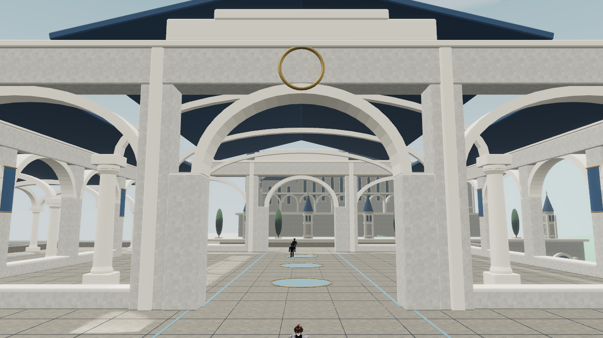
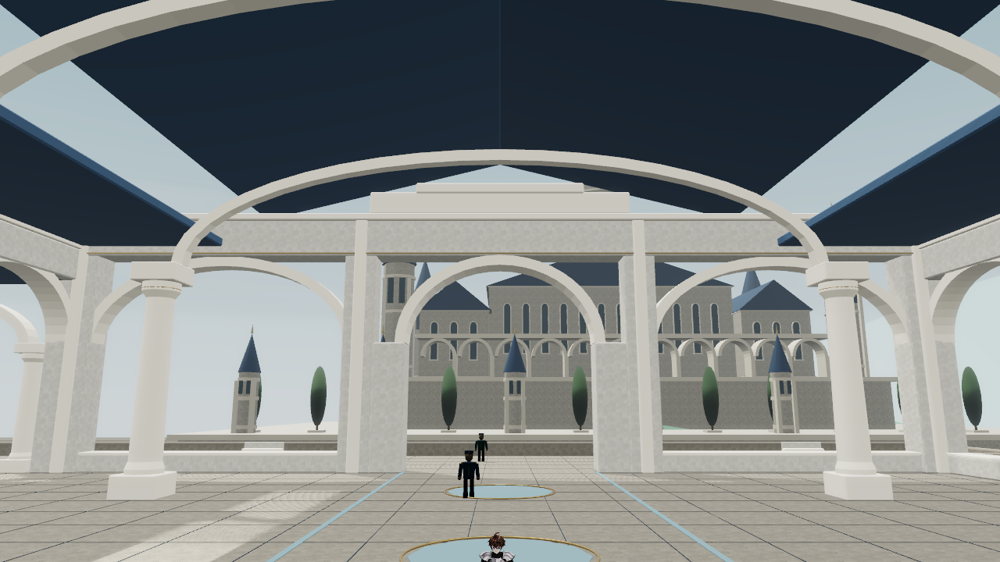
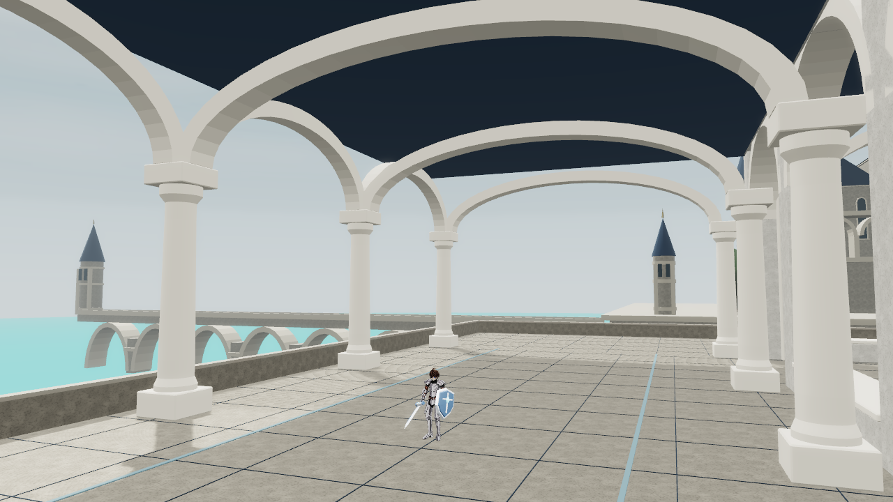

# White City public spaces and palace performance - 2026-10-21

## Delivered behavior

- Free exploration replaces mandatory opening/report conversations. Existing saves and optional character stories remain; no story progression is required for the ten existing 2D/3D stages.
- Named hosts are distributed across the city, with short greetings in the existing introduction UI and START EXPEDITION as the default action.
- The forecourt connects to a courtyard, enterable great hall, sea cloister and north viewing terrace. Shared floors drive rendering, Havok support, ground probes and map footprints.
- course-5 host is inside the hall at (-8.6,265); palace-1-5 host is on the viewing terrace at (-8.6,285), both at floor y12.
- Actual-scene regional atlas recaptured at 1024x1024, X[-325,280], Z[-302,303]. Tests validate PNG SHA and capture receipt.
- Shared humanoid hosts and procedural castle details are placeholders pending Tripo/manual art. No new minigame systems were added.

## Performance: corrected target is 2D 1-5

The user corrected 1-4 to 1-5; both were checked because they share the guard renderer. Offscreen visual rigs and IK posing are culled, while patrol/combat simulation continues. An 8 m camera-frustum margin keeps nearby guards/shadows; accumulated stride is restored on return. Defeat/reset are regression-tested.

Desktop in-app browser, 1280x720, same stationary spawn, 10-second samples. CPU time is the instrumented update/render call, not GPU frame time.

| Stage | Metric | Before | After |
| --- | --- | ---: | ---: |
| 1-5 | Mean CPU update/render | 9.558 ms | 7.028 ms |
| 1-5 | P95 CPU update/render | 10.7 ms | 7.9 ms |
| 1-5 | Draw calls | 844 | 784 |
| 1-5 | Active indices | 13,550,454 | 4,347,594 |
| 1-5 | Enabled knight rigs | 21 | 1 |
| 1-4 | Mean CPU update/render | 6.003 ms | 4.657 ms |
| 1-4 | Draw calls | 517 | 490 |
| 1-4 | Active indices | 8,009,049 | 3,867,762 |

1-5: approximately 26% less CPU update/render time and 68% fewer active indices at spawn. Both desktop runs were near 60 FPS; this is not a mobile FPS claim. Android/AYN Thor is unmeasured. A nearby-building shadow experiment had no meaningful draw-call benefit and was not shipped.

## Verification

- Actual keyboard-driven 1-5 route reached settlement: 47/57 coins, 4/4 checkpoints, one fall. Elapsed 85.7 s includes QA idle time, not a target-time benchmark.
- Actual keyboard-driven 1-4 route reached settlement: 25/29 coins, 10/10 guards, 2/2 checkpoints, no falls.
- Real Havok capsule tests traverse the hall/cloister loop and both side passages. Window sills block passage; camera and collision checks pass.
- Actual RegionSession loaded in the hall without AVG. Clicking the course-5 host opened the correct greeting/target-time introduction and focused START EXPEDITION. Scene reported no errors.
- Full Vitest: 199 files / 1,236 tests passed. TypeScript/Svelte: zero errors or warnings. Production build and verify-build passed (session CSS, PWA icons/manifest/offline shell). Existing Vite large-chunk advisory remains.
- Independent code review found no actionable correctness issues. Final atlas receipt and integrated suite passed afterward.
- All browser QA previews were muted.

## Scene captures

Next art pass: docs/art/white-palace-model-wishlist.md. Public routes are playable; NPC models, materials and architecture still need artistic refinement.
